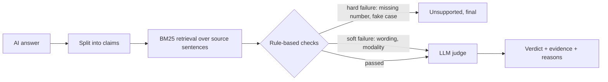

# Verdict

Claim-level grounding checks for AI-written legal text. Give it an AI answer and the documents it was supposed to rely on, and it checks every sentence: is this actually in the sources, with the right numbers, the right obligations, and real case law?

The worst failures in legal AI aren't vague answers. They're confident ones that are subtly wrong: a 30-day deadline that becomes 45, a "does not survive" that becomes "survives," a "may" that becomes "must," or a case citation that looks perfect and doesn't exist. Verdict targets each of those directly, and explains every flag with the exact source passage it checked.

```
$ python -m verdict check --answer examples/answer.txt --sources evals/sources \
    --known-cases examples/known_cases.json --html examples/report.html

4 of 9 claims unsupported (grounding rate 56%)

1. [FLAG] Customer pays Provider a monthly fee of $12,500, and payment is due within 45 days of the invoice date.
     - not in source: 45 days
     source (services_agreement): "Payment is due within thirty (30) days of the invoice date."
5. [FLAG] Confidentiality obligations do not survive termination of the agreement.
     - claim adds a negation the source doesn't have
7. [FLAG] Provider must maintain cyber liability insurance of at least $5 million.
     - only 14% of the claim's key terms appear in the closest source passage
     - not in source: $5,000,000
9. [FLAG] Courts have also held that plausibility review does not apply to contract claims.
          Harrington v. Delmont Logistics, 612 U.S. 118 (2021).
     - citation could not be verified: no case at this volume/reporter/page
```

Claim 6 ("liability for confidentiality breaches is limited...") passes the rule-based checks even though the source explicitly exempts confidentiality breaches from the cap. That's the ignored-exception case the LLM judge is there for.

Add `--html report.html` to get the same result as an annotated page: the answer with every claim marked, and margin notes showing the source passage each one was checked against.

## What it checks

| Check | Catches | Example |
|---|---|---|
| Quantities with units | Wrong deadlines, amounts, rates | Source: "thirty (30) days". Claim: "45 days" |
| Negation | Flipped meaning | Source: "does not roll over". Claim: "rolls over" |
| Modality | Obligations and permissions swapped | Source: "may work remotely". Claim: "must work remotely" |
| Exclusivity | Invented limits | Source: "Either party may terminate". Claim: "Only the Customer may terminate" |
| Coverage | Claims about things the sources never mention | "Provider must maintain $5M cyber insurance" |
| Citations | Fabricated or misattributed cases | "Harrington v. Delmont Logistics, 612 U.S. 118 (2021)" |

The legal-text handling matters more than it looks. Naive sentence splitters break "Bell Atlantic Corp. v. Twombly, 550 U.S. 544 (2007)" into four sentences, and naive number matching can't tell that "thirty (30) days," "30 days," and "twenty-four months" vs. "24 months" are the same thing, or that "two years" and "two adults" are not.

## Results

Measured on a labeled benchmark of claims written against four fictional legal documents (a services agreement, a municipal ordinance, a litigation memo citing real Supreme Court cases, and an employee handbook). "Positive" means unsupported, the thing we want to catch.

| Set | Claims | Precision | Recall | F1 |
|---|---|---|---|---|
| Dev (used while building the checks) | 40 | 100% | 90% | 0.94 |
| **Holdout (written afterwards, never tuned on)** | 18 | **69%** | **100%** | **0.82** |

The holdout number is the honest one. The checks generalize well at catching bad claims (every unsupported holdout claim was flagged) but over-flag some faithful paraphrases, like "Written notice is required before terminating for convenience" for a clause that says termination is allowed "upon prior written notice."

That trade is intentional for legal work: a lawyer dismisses a false alarm in seconds, while a missed fabricated citation ends up in a filing. The optional LLM judge (below) exists to recover precision on exactly those soft cases.

Two error types the rule-based checks miss by design: **ignored exceptions** ("liability is capped" when the cap explicitly excludes confidentiality breaches) and **numbers borrowed from a neighboring clause** ($1,000 for a first violation when $1,000 is the fine for repeat violations). Both need reasoning, not pattern matching.

## Hybrid design: fast checks first, LLM judge second



- **Hard failures are never overridden.** A number that appears nowhere in the source, or a citation that doesn't resolve, is a fact, not a judgment call.
- **The judge only sees what needs judgment.** Claims that passed every check get a second look for subtle errors. Claims that failed only soft checks can be cleared if they're faithful paraphrases.
- Most claims never need an LLM call, which keeps it fast, cheap, and auditable.

## Run it

```bash
pip install -r requirements.txt
pytest                                    # 20 tests
python -m verdict eval                    # dev benchmark
python -m verdict eval --set holdout      # holdout benchmark

python -m verdict check \
  --answer examples/answer.txt \
  --sources evals/sources \
  --known-cases examples/known_cases.json \
  --html examples/report.html
```

With live services:

```bash
# Verify citations against CourtListener's citation lookup API (free token at courtlistener.com)
COURTLISTENER_TOKEN=... python -m verdict check --answer a.txt --sources docs/ --courtlistener

# LLM judge on Together AI
TOGETHER_API_KEY=... python -m verdict check --answer a.txt --sources docs/ --judge together
```

`--fail-on-unsupported` exits with code 1 when anything is flagged, so it can gate a pipeline in CI.

## Project layout

| Path | Contents |
|---|---|
| `verdict/text.py` | Legal-aware sentence splitting, quantities with units, negation and modality detection |
| `verdict/checker.py` | Retrieval, claim checks, hard vs. soft failures, judge integration |
| `verdict/citations.py` | Citation extraction, CourtListener and offline verifiers |
| `verdict/judge.py` | Together AI judge with a strict JSON verdict format |
| `verdict/report.py` | Terminal and annotated HTML reports |
| `evals/` | Source documents, labeled dev and holdout sets, scoring script |

## Limitations

- The benchmark is small (58 claims) and hand-written. It's enough to measure the trade-offs honestly, not to claim production accuracy.
- Retrieval is lexical (BM25). Claims phrased with very different vocabulary from the source can fall below the coverage threshold. Embedding retrieval would help.
- Negation and modality detection are pattern-based and sentence-local.
- Judge results aren't included in the numbers above, because they depend on the model and need a live API key to measure.

## Next steps

- Measure the judge on both benchmark sets and report the precision and recall it adds.
- Swap BM25 for hybrid lexical + embedding retrieval.
- Grow the benchmark with real-world legal AI outputs and harder error types (swapped parties, wrong jurisdiction).

All documents in `evals/sources` are fictional. Case citations in the litigation memo are real Supreme Court decisions.
